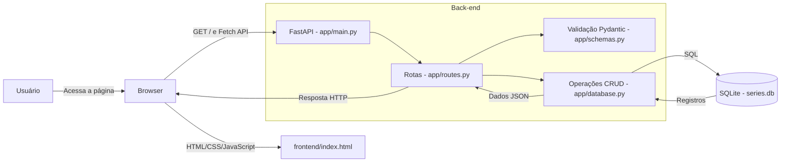
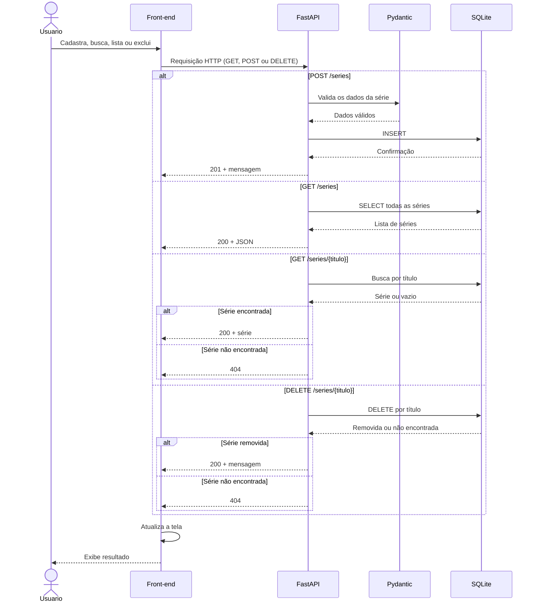

# 🎬 Catálogo de Séries API & Web App

Aplicação Full-Stack leve desenvolvida em Python com **FastAPI**, **SQLite** e **HTML/CSS/JavaScript**, permitindo cadastrar, listar, buscar e remover séries através de uma API RESTful ou diretamente pela interface web integrada.

## 🚀 Evolução do Projeto por Etapas

1. **Cadastro e Validação (`POST /series`)**: Estruturação modular da API e criação de modelos com **Pydantic** para validar regras de negócio (ano de lançamento > 1900 e temporadas > 0).
2. **Listagem do Catálogo (`GET /series`)**: Implementação da consulta completa de todas as séries registradas em formato JSON.
3. **Banco de Dados SQLite e Busca Específica (`GET /series/{titulo}`)**: Migração da persistência para **SQLite (`sqlite3`)**, adicionando busca *case-insensitive* por título e tratamento de status HTTP (`201`, `400`, `404`).
4. **Remoção e Interface Web (`DELETE /series/{titulo}` & Front-end)**: Criação da rota de exclusão e desenvolvimento de uma interface em HTML/JS puro servida diretamente pelo FastAPI (`FileResponse`) via `fetch` API.

## 📁 Estrutura do Projeto

```text
catalogue_series/
├── app/
│   ├── __init__.py       # Inicialização do pacote Python
│   ├── main.py           # Configuração do FastAPI, CORS e rota do Front-end
│   ├── schemas.py        # Modelos de validação Pydantic
│   ├── database.py       # Conexão e operações CRUD com SQLite
│   └── routes.py         # Endpoints da API (/series)
├── frontend/
│   └── index.html        # Interface web (HTML, CSS e JavaScript)
├── .gitignore            # Arquivos ignorados pelo Git (venv, __pycache__, .db)
├── requirements.txt      # Dependências do projeto
└── README.md             # Documentação do repositório
```

## 🛠️ Tecnologias Utilizadas

* **Back-end:** Python 3, FastAPI, Pydantic, Uvicorn
* **Banco de Dados:** SQLite (`sqlite3`)
* **Front-end:** HTML5, CSS3, JavaScript (Fetch API)

## 🧩 Desenho do Sistema



## 🔄 Fluxo de Trabalho



## ⚙️ Como Executar Localmente

1. **Clone o repositório:**
   ```bash
   git clone https://github.com/JuliaLavagnini/catagolo_series
   cd catalogue-series
   ```

2. **Crie e ative um ambiente virtual:**
   ```bash
   python -m venv venv
   # No Windows:
   venv\Scripts\activate
   # No Linux/Mac:
   source venv/bin/activate
   ```

3. **Instale as dependências:**
   ```bash
   pip install -r requirements.txt
   ```

4. **Inicie o servidor:**
   ```bash
   uvicorn app.main:app --reload
   ```

5. **Acesse a aplicação:**
   * **Interface Web:** `http://127.0.0.1:8000`
   * **Documentação da API (Swagger UI):** `http://127.0.0`
