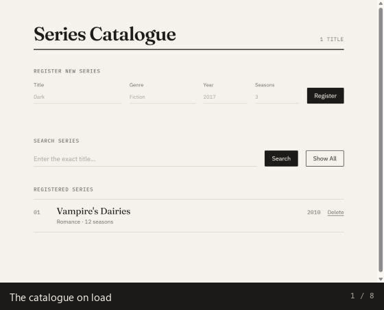
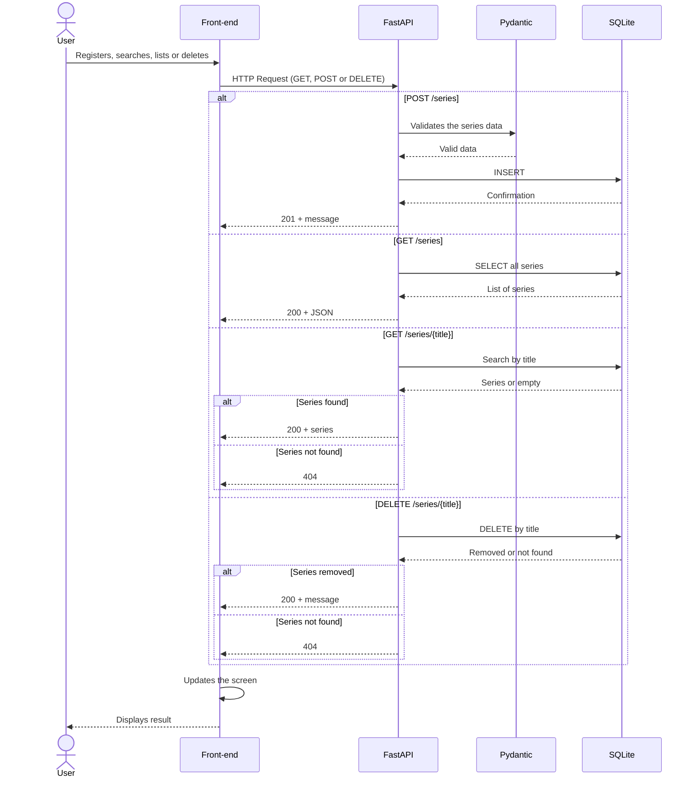

# 🎬 Series Catalogue API & Web App

Lightweight Full-Stack application built in Python with **FastAPI**, **SQLite** and **HTML/CSS/JavaScript**, allowing you to register, list, search and remove series through a RESTful API or directly through the integrated web interface.



## 🚀 Project Evolution by Stages

1. **Registration and Validation (`POST /series`)**: Modular structuring of the API and creation of models with **Pydantic** to validate business rules (release year > 1900 and seasons > 0).
2. **Catalogue Listing (`GET /series`)**: Implementation of the full query of all registered series in JSON format.
3. **SQLite Database and Specific Search (`GET /series/{title}`)**: Migration of persistence to **SQLite (`sqlite3`)**, adding *case-insensitive* search by title and HTTP status handling (`201`, `400`, `404`).
4. **Removal and Web Interface (`DELETE /series/{title}` & Front-end)**: Creation of the delete route and development of a pure HTML/JS interface served directly by FastAPI (`FileResponse`) via the `fetch` API.

## 📁 Project Structure

```text
catalogue_series/
├── app/
│   ├── __init__.py       # Python package initialization
│   ├── main.py           # FastAPI configuration, CORS and Front-end route
│   ├── schemas.py        # Pydantic validation models
│   ├── database.py       # SQLite connection and CRUD operations
│   └── routes.py         # API endpoints (/series)
├── frontend/
│   └── index.html        # Web interface (HTML, CSS and JavaScript)
├── .gitignore            # Files ignored by Git (venv, __pycache__, .db)
├── requirements.txt      # Project dependencies
└── README.md             # Repository documentation
```

## 🛠️ Technologies Used

* **Back-end:** Python 3, FastAPI, Pydantic, Uvicorn
* **Database:** SQLite (`sqlite3`)
* **Front-end:** HTML5, CSS3, JavaScript (Fetch API)

## 🧩 System Design


## 🔄 Workflow



## ⚙️ How to Run Locally

1. **Clone the repository:**
   ```bash
   git clone https://github.com/JuliaLavagnini/catagolo_series
   cd catalogue-series
   ```

2. **Create and activate a virtual environment:**
   ```bash
   python -m venv venv
   # On Windows:
   venv\Scripts\activate
   # On Linux/Mac:
   source venv/bin/activate
   ```

3. **Install the dependencies:**
   ```bash
   pip install -r requirements.txt
   ```

4. **Start the server:**
   ```bash
   uvicorn app.main:app --reload
   ```

5. **Access the application:**
   * **Web Interface:** `http://127.0.0.1:8000`
   * **API Documentation (Swagger UI):** `http://localhost:8000/docs`
